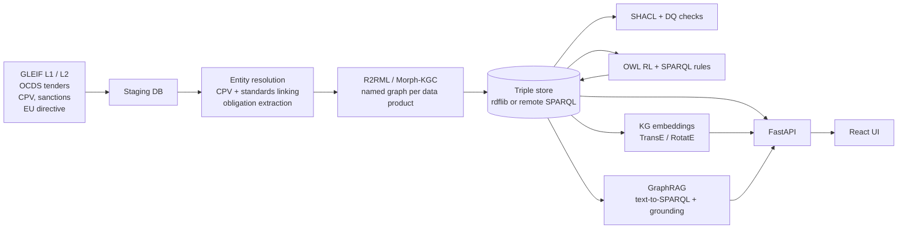

# SupplierGraph

**A knowledge graph for German/EU public procurement and supplier risk, built from open data: legal entities and ownership (GLEIF), tenders and awards (OCDS), product categories (CPV), sanction lists and EU procurement law.**

SupplierGraph is a portfolio project that covers the full knowledge-graph life cycle on real data: ontology design, R2RML integration, entity resolution, SHACL validation, rule-based reasoning, KG embeddings, text-to-SPARQL question answering with grounding checks, a REST API and a web UI.

> **Read this first.** This is a research/portfolio prototype run on a *sample* of the data (20,000 tenders). Sanction matches and exposure flags are **leads for human review, not findings**. The evaluation numbers below are modest on purpose: they are reported as measured, including the weak ones. Check the licence of every data source before reuse (see [Data](#data-and-licences)).

---

## What it does

| Stage | What is implemented |
|---|---|
| **Ontology** | OWL 2 ontology (`ontology/suppliergraph.ttl`): legal entities, buyers, suppliers, tenders, awards, product categories, sanction matches, exposure flags, regulations, obligations, data products |
| **Integration** | Staging database (SQLAlchemy, SQLite or Postgres) and an R2RML mapping materialised with Morph-KGC into one named graph per data product, with provenance |
| **Entity resolution** | German-aware name normalisation, character n-gram TF-IDF blocking by country, fuzzy scoring (rapidfuzz), accept / review / reject decisions, identifier-masked evaluation |
| **Validation** | SHACL shapes (pyshacl) and data-quality checks (e.g. derived vs published ultimate parent) |
| **Reasoning** | OWL 2 RL (owlrl) plus SPARQL CONSTRUCT rules: derived ultimate parent, buyer-supplier contracts, supplier categories, sanction exposure along the ownership chain |
| **Extraction** | CPV linking, technical standards (regex), and obligations from EU Directive 2014/24 (LLM, with a verbatim-source check and duty-wording filter) |
| **Embeddings** | TransE / RotatE (PyTorch) for supplier recommendation, with a temporal split and non-learned baselines |
| **GraphRAG** | Text-to-SPARQL with schema grounding, a validation and repair loop, document retrieval, and a deterministic grounding checker; compared against LLM-only and vector-RAG baselines |
| **Serving** | FastAPI (JSON-LD content negotiation, guarded SPARQL endpoint) and a React / Cytoscape UI |

### Architecture



---

## Results (run of 21 Nov 2026)

Everything below was produced by running this repository on real data in Google Colab. Settings: GLEIF restricted to `DE`, first **20,000** OCDS releases, Llama-3.1-8B-Instruct via Hugging Face Inference Providers.

**Data loaded**

| Source | Loaded |
|---|---|
| GLEIF entities (Germany) / relationships | 260,558 / 10,745 |
| OCDS tenders / awards / parties / tender-CPV links | 20,000 / 3,527 / 8,161 / 35,561 |
| CPV codes | 9,454 |
| Sanction entries | 25,398 |

**Knowledge graph:** 400,532 triples (274,682 materialised + 120,591 inferred by OWL RL, plus rule output). Rules derived 100 ultimate-parent links, 1,623 buyer-supplier contracts, 3,222 supplier-category links and 7 sanction exposure flags. **SHACL: conforms, 0 violations.**

**Entity resolution (tender parties against GLEIF):** 1,526 accepted, 2,116 queued for review, 4,519 unmatched. 1,464 entities are in the graph scope; 12 sanction matches were found, all for human review. **No accuracy figure is reported:** the identifier-masked evaluation had 0 usable cases, because no party in this sample carries a published LEI.

**Supplier recommendation** (temporal split, 259 test awards, RotatE):

| Slice | RotatE MRR / hits@10 | Popularity MRR / hits@10 |
|---|---|---|
| All | 0.038 / 0.039 | 0.003 / 0.004 |
| New buyer-supplier pairs (251) | 0.007 / 0.008 | 0.003 / 0.004 |
| Repeat pairs (8) | 1.0 / 1.0 | 0.010 / 0.0 |

The embedding model beats popularity, but on new pairs it is barely above chance and a simple buyer-history baseline matches it overall. The result is reported as a baseline comparison, not as a useful recommender; a 20,000-tender sample is probably too small.

**Question answering, 14 competency questions** (first run, before the prompt fixes described below):

| System | Answer recall | Grounded | Hallucination | Exec. accuracy |
|---|---|---|---|---|
| GraphRAG | 0.091 | 0.786 | 0.214 | 0.143 |
| Vector RAG | 0.0 | 1.0 | 0.0 | n/a |
| LLM only | 0.0 | 0.143 | 0.857 | n/a |

GraphRAG is the only system with non-zero answer recall and hallucinates far less than the LLM-only baseline, but absolute accuracy is low. Vector RAG's perfect grounding comes with zero recall. Since this run, the prompt was changed (placeholder removed, worked examples, length and generic-filter guards, property-direction hints). **Those changes have not been re-evaluated.** Obligation extraction was also tightened (definitions skipped, duty wording required) after a manual check showed that the first run labelled definition clauses as duties; the new run has not been audited.

Full method notes: [`docs/evaluation.md`](docs/evaluation.md).

---

## Quick start

### Option A: Google Colab (recommended for real data)
1. Put in Google Drive: GLEIF Level 1 and Level 2 golden-copy zips, the OCDS `full.jsonl.gz` of [publication 136](https://data.open-contracting.org/en/publication/136), the CPV zip, `targets.simple.csv`, the CELEX PDF of Directive 2014/24, and a zip of this repository.
2. Add `HF_TOKEN` (or `ANTHROPIC_API_KEY`) to Colab Secrets, then open [`colab/SupplierGraph_Colab.ipynb`](colab/SupplierGraph_Colab.ipynb), set `DRIVE_ROOT`, `LLM_MODEL` and `OCDS_LIMIT`, and run the cells in order.
3. Results (graph, staging DB, models, evaluation) are saved to Drive; after a restart use the restore cell instead of rebuilding.

### Option B: local
```bash
pip install -e ".[etl,ml,llm,dev]"          # Python >= 3.11; morph-kgc needs `falcon`
(cd ui && npm install && npm run build)
pytest                                       # runs on small fictional fixtures only

# real data: files under data/raw (layout in config/sources.yaml); scripts/colab_prepare.py can stage them from a folder
sg data check gleif1 data/raw/gleif/level1.csv   # also gleif2, cpv, sanctions, ocds
sg init-db && sg ingest --countries DE && sg resolve && sg extract && sg build-kg && sg validate
sg er-eval && sg train && sg train --final
sg eval                                      # competency-question evaluation (needs an LLM)
sg serve                                     # http://127.0.0.1:8000
```

### Choosing an LLM
| Provider | Setup |
|---|---|
| Anthropic | `ANTHROPIC_API_KEY`, optional `SG_LLM_MODEL` |
| Hugging Face Inference Providers | `SG_LLM_PROVIDER=hf`, `HF_TOKEN`, `SG_LLM_MODEL=<org/model>` (needs available credits) |
| Any OpenAI-compatible server (Ollama, vLLM) | `SG_LLM_PROVIDER=openai_compat`, `SG_LLM_BASE_URL`, `SG_LLM_MODEL` |

Smaller open models are weaker at text-to-SPARQL and JSON output; compare models with `sg eval`.

---

## Repository layout

```
suppliergraph/
├── README.md
├── pyproject.toml, Makefile, Dockerfile, docker-compose.yml, .env.example
├── ontology/            OWL ontology
├── shapes/              SHACL shapes
├── mappings/            R2RML mapping
├── sparql/rules/        CONSTRUCT rules (ultimate parent, contracts, categories, sanction exposure)
├── config/              sources, data products, regulations
├── src/suppliergraph/
│   ├── ingest/          GLEIF, OCDS (streaming), CPV, sanctions loaders and format checks
│   ├── staging/         schema and database helpers
│   ├── er/              normalisation, blocking, matching, evaluation
│   ├── extract/         CPV linking, standards, obligations, PDF to text
│   ├── kg/              build, SHACL, entity views, graph explorer
│   ├── reasoning/       OWL RL, rules, data-quality checks
│   ├── store/           rdflib store and remote SPARQL store
│   ├── ml/              datasets, TransE/RotatE, baselines, recommender
│   ├── rag/             text-to-SPARQL, retrieval, answer engine, grounding checker
│   ├── eval/            competency questions and runner
│   ├── api/             FastAPI application
│   └── llm.py, cli.py, pipeline.py
├── ui/                  React + Vite + Cytoscape front end
├── colab/               Colab notebook and its generator
├── scripts/             data staging for Colab, static demo, benchmarks
├── tests/               46 tests on small fictional fixtures
├── docs/                design notes, data sources, evaluation, static demo
├── deploy/              optional GraphDB / Ontop setup (untested)
├── data/                raw and processed data (git-ignored)
└── models/              trained embeddings (git-ignored)
```

## API

`GET /api/health`, `POST /api/ask`, `GET /api/entities/search`, `GET /api/entities/{key}` (JSON-LD via `Accept: application/ld+json`), `.../contracts`, `.../graph`, `.../lineage`, `GET /api/discover/{buyers,categories,suppliers}`, `GET /api/governance/{shacl,dq,er,products}`, `GET /api/models`, `POST /api/sparql` (disabled unless `SG_ALLOW_RAW_SPARQL=1`).

## Data and licences

| Source | Used for | Licence note |
|---|---|---|
| [GLEIF](https://www.gleif.org/en/lei-data/gleif-golden-copy) Level 1 and Level 2 | entities and ownership | Check GLEIF's current terms |
| [OCP Data Registry](https://data.open-contracting.org/en/publication/136), publication 136 (Germany) | tenders and awards | Published as CC0 on the registry page; verify |
| EU Publications Office CPV 2008 | product categories | Verify reuse terms |
| OpenSanctions `targets.simple.csv` | sanction entries | **Non-commercial terms may apply; verify before any commercial use** |
| EUR-Lex, Directive 2014/24/EU | obligation extraction | Verify reuse terms |

No data files are included in this repository. The code is released under the licence in `LICENSE`.

## Known limitations
- Sample, not full data: 20,000 releases and German GLEIF entities only. Full-scale entity-resolution speed is untested.
- No entity-resolution accuracy figure (no LEI-bearing parties in the sample).
- Low text-to-SPARQL accuracy with an 8B model; the later prompt fixes are not re-evaluated.
- Obligation extraction is a heuristic (LLM, verbatim check, duty-wording filter) and needs manual review.
- The recommender is not useful on new buyer-supplier pairs with this data size.
- Untested: Docker Compose, GraphDB, Ontop, the remote SPARQL store, Postgres.
- The `data/` and `models/` folders are not versioned; results depend on the data snapshot (GLEIF golden copy of 20 Nov 2026).

## Ideas for next steps
Full OCDS volume; alignment to the EU eProcurement Ontology (ePO); an LEI-labelled evaluation set for entity resolution; a larger model or a fine-tuned text-to-SPARQL model; human-reviewed obligation labels; an embedded graph view in the UI.

## Development
```bash
make install && make test && make lint
```
Tests use fictional fixtures only; no real company data is in the repository.
